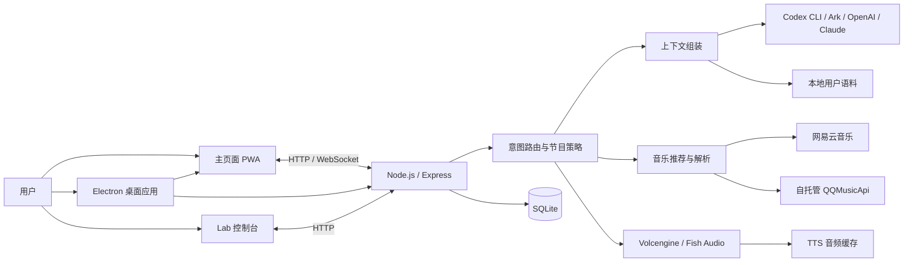
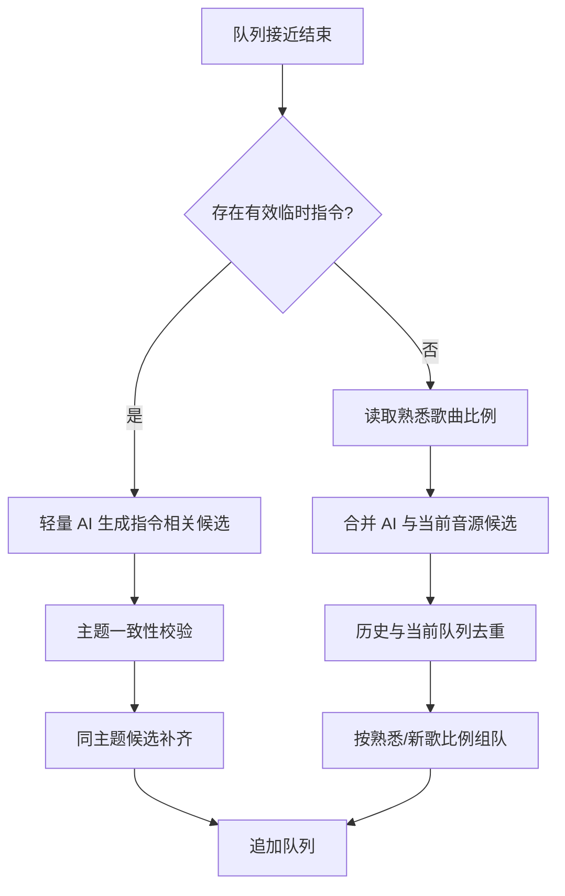

# Forever 产品说明文档

> 版本：1.3.0  
> 更新日期：2026-10-02  
> 产品形态：本地优先的私人 AI 电台，提供 Web/PWA 与 Windows、macOS 桌面应用

## 1. 产品概述

Forever（原 Swagger AI Radio）是一个持续在线的私人 AI 电台。它将大模型、个人音乐偏好、网易云/QQ 音乐、语音合成和本地记忆组合成一个可对话、可连续播放、可长期调节的 AI DJ。

用户可以像对真人 DJ 一样表达需求，例如：

- “来一点适合工作的低干扰音乐。”
- “下一首。”
- “近两个小时都改成白噪音。”
- “多放一些没听过的民谣。”

系统会理解意图、规划歌单、控制播放器、生成简短串场，并持续补充后续队列。

产品当前处于可运行原型阶段，已经完成多音源、AI 对话、语音播报、个性化推荐、桌面分发和本地数据持久化的闭环，但尚未进行规模化用户增长和商业化验证。

## 2. 产品目标

1. 将选歌、播放控制和语音陪伴整合为一个连续体验。
2. 根据用户品味、历史播放、当前环境和临时指令动态推荐内容。
3. 保持本地优先：配置、密钥、记忆和播放记录由本机服务管理。
4. 在外部服务不可用时提供可降级的基本播放与交互能力。
5. 通过直接播放、歌单浏览和互动选择三种回复方式，适配不同决策成本的音乐需求。

## 3. 目标用户

- 希望减少手动选歌成本的个人用户。
- 需要工作、午休、阅读或睡眠背景音的人群。
- 对音乐类型有大致方向，但难以准确描述风格、情绪或场景的人群。
- 希望先比较多个音乐方向，再决定播放内容的探索型用户。
- 希望拥有长期记忆和个性化表达风格的 AI 助手用户。
- 需要调试 LLM、TTS、音乐推荐与 Agent 行为的开发者。

## 4. 核心体验

### 4.1 AI DJ 对话

主页面提供流式聊天区域，支持文本和语音输入。

- 首次进入时，开场语会结合当前时间段、连接状态、播放/暂停状态、当前歌曲、剩余队列和临时节目策略动态生成。
- 浏览器会记住上一条开场语，并从同一上下文的其他候选中选择，避免连续刷新出现完全相同的文案。
- 播放状态、当前歌曲、临时策略或连接状态变化时，开场语会同步刷新；时间本身每秒更新，但文案只在语义上下文变化时更新。
- 自然语言点歌、推荐和播放控制。
- 支持播放、暂停、上一首、下一首和停止。
- AI 回复包含播报文本、播放计划、推荐原因和过渡语。
- 模型输出统一遵循：

```json
{
  "say": "DJ 播报内容",
  "play": ["歌曲搜索词或歌曲 ID"],
  "reason": "推荐原因",
  "segue": "过渡语",
  "playerAction": "none",
  "choices": []
}
```

- Lab 可切换“直接播放”“歌单卡片”“互动选择”三种回复风格。
- 歌单卡片只展示已经解析成功的真实歌曲，可播放全部或从指定歌曲开始。
- 互动选择模式允许模型在需求宽泛时返回 2–4 个方向；点击后发送一次完整约束。
- 桌面端可在非输入控件区域长按空格说话。
- 触屏端可长按消息输入框，松开后自动发送。
- 聊天区支持专注全屏模式，按 `Esc` 退出。

### 4.2 连续音乐播放

播放器使用单一 `<audio>` 音频通道，避免音乐和播报同时播放。

- 支持播放、暂停、停止、上一首和下一首。
- 曲目自然结束后自动进入下一首。
- 队列不足时提前生成下一批内容。
- 音频源失败时自动重试一次，仍失败则继续下一首。
- AI 播报结束后从正确进度恢复音乐。
- 支持音量、进度拖动、收藏筛选和队列点选。
- 播放器可吸顶，吸顶状态保存在浏览器本地。
- 播放器可折叠为动态波形入口。

### 4.3 自动推荐

默认每批生成 6 条内容。

通用推荐策略综合：

- AI 推荐结果。
- 当前配置的音乐来源；自动模式按网易云优先、QQ 音乐兜底。
- 网易云私人 FM。
- 网易云每日推荐。
- 当前曲目的相似歌曲。
- 网易云新歌推荐。
- Forever 本地播放历史。
- 网易云最近播放记录。
- 当前队列中的歌曲。

推荐规则：

- 默认熟悉歌曲比例为 17%，即约 1 首听过的歌曲和 5 首新歌。
- 熟悉歌曲比例可在 Lab 中设置为 `0%–100%`。
- 新歌会排除本地历史、网易云最近播放和当前最多 300 条队列记录。
- 每次歌曲真实开始播放后才写入本地历史。
- 同一首歌暂停恢复不会重复写入历史。
- 通用推荐中可选取特殊曲目，由 AI DJ 在播放前进行一句简短介绍。

### 4.4 临时节目指令

系统能识别具有持续时间或连续语义的明确指令，例如：

- “接下来 30 分钟只听爵士。”
- “近两个小时暂时都改成白噪音。”
- “多来一些民谣。”

行为规则：

1. 指令保存到 SQLite，并带有到期时间。
2. 未明确时长的“多来一些”类请求默认持续 120 分钟。
3. 指令有效期内暂停通用熟悉歌比例。
4. 续播使用轻量 AI 通道优先生成符合指令的搜索词。
5. 通用私人 FM、每日推荐和相似歌曲不再参与补位。
6. 对白噪音等环境声进行主题一致性校验。
7. AI 候选不足时，只使用相同主题的严格候选池补齐。
8. 到期后自动恢复通用混合推荐。
9. 用户可以说“恢复默认推荐”提前取消。

Lab 的“推荐”分页会展示当前生效策略、指令原文、剩余时间和到期时间，并支持修正、续期或关闭。

### 4.5 舞台信息

播放器上方的舞台支持三种视图：

- 时间：当前时间、星期和日期。
- 歌词：按曲目来源获取网易云或 QQ 音乐歌词，并按播放进度滚动高亮。
- 评论：网易云歌曲展示热门评论与近期评论；QQ 音乐暂不展示评论。

### 4.6 AI 语音

AI 回复优先生成服务端语音并缓存。

支持的语音服务：

- Volcengine TTS。
- Fish Audio。
- Browser Speech 本地回退。

Volcengine TTS 支持：

- 官方音色。
- 自定义声音复刻 `speaker_id`。
- 标准或表现力增强模型。
- 情绪、情绪强度、语速和音量。
- 声音导演提示词。

生成的音频按文本和配置哈希缓存到 `cache/tts/`。

### 4.7 DJ 档案

点击主页面顶部头像可查看助手档案，包括：

- 自定义助手名称和头像。
- 内置本地默认人像，断网也能显示；自定义头像缺失时自动回退。
- 在线状态。
- 音乐风格标签。
- 本地品味记忆。

助手名称会同步到：

- Lab 顶栏。
- 页面标题。
- 主页面消息作者。
- DJ 档案和身份文案。

### 4.8 首次使用引导

- 首次进入电台时，使用聚光区域与示意光标介绍播放、队列、收藏、对话、语音和 Lab 入口。
- 引导进入 Lab 后，继续解释模型、语音、音乐账号、推荐策略、身份和外观配置。
- 完成或跳过状态保存在当前客户端，后续不会重复打扰；“使用指南”入口支持随时重看。
- 引导只解释界面，不会自动播放、发送消息、登录账号或保存设置。
- Lab 的填写项提供 hover、键盘聚焦和触屏点击提示，包含用途、填写示例、获取方式及官方文档入口。

### 4.9 桌面应用

- 使用 Electron 复用网页端播放器、Lab、HTTP API 与 WebSocket，不维护另一套业务逻辑。
- macOS 提供 Apple Silicon 与 Intel 安装包；Windows 提供安装版与便携版。
- 桌面端启动时清理旧 Service Worker 和 Cache Storage，避免版本升级后继续运行旧前端脚本；SQLite、Local Storage、头像、历史和服务凭据不受影响。
- 桌面端不注册 PWA Service Worker，确保三种推荐模式和页面组件始终与安装版本一致。
- 经典电台、唱片沉浸和玻璃桌面针对桌面窗口分别约束舞台、唱片、队列、对话和输入区域的尺寸与滚动边界。
- 退出应用时停止内嵌本地服务；macOS 关闭窗口后可从 Dock 重新打开，单实例机制避免重复启动多个播放器。

## 5. Lab 控制台

Lab 地址：

```text
http://localhost:8080/debug.html
```

Lab 使用顶部六分页，每个分页独立保存。修改内容只保留为本地草稿，点击该分页的“保存并同步”后才写入服务端。

### 5.1 身份

- 修改助手名称。
- 选择头像并本地预览。
- 恢复默认头像。
- 保存后同步主页面、消息头像、页面标题和 Lab 顶栏。

### 5.2 记忆

- 编辑音乐风格标签。
- 编辑 `taste.md` 用户品味语料。
- 保存后写入本地文件和 SQLite 配置。

### 5.3 推荐

- 切换直接播放、歌单卡片或互动选择回复风格。
- 调整听过歌曲重复率。
- 查看当前生效策略。
- 查看临时指令剩余时间和到期时间。
- 开启或关闭临时 AI 指令。
- 编辑指令内容。
- 设置持续时间，范围为 15–1440 分钟。

### 5.4 服务

LLM 支持：

- Codex CLI，可复用 ChatGPT 登录态且无需在应用中保存 API Key。
- Volcengine Ark。
- OpenAI。
- Anthropic Claude。
- OpenAI-compatible 服务。

语音支持：

- Volcengine TTS。
- Fish Audio。
- Browser Speech。

音乐服务支持：

- 自动选择、仅网易云、仅 QQ 音乐三种模式。
- 网易云二维码登录。
- 桌面端通过隔离的 QQ 音乐官方窗口扫码登录；网页端保留手动 Cookie。
- QQ 登录窗口只读取播放所需的 `qq.com` 白名单 Cookie，关闭、超时或登录失败时不覆盖原配置。
- Lab 展示未登录、等待扫码、登录成功、失败和已退出状态，并支持重新登录。
- 自托管 QQMusicApi Base URL、独立 Cookie 与音质配置。
- 两个音源分别选择播放音质。
- 登录状态和会员状态展示。

密钥规则：

- 密钥仅保存在服务端 SQLite 或 `.env`。
- 前端只显示掩码和最后四位。
- 不同服务商的 Key 分开保存，切换服务商不会互相覆盖。
- 空白输入不会清除现有 Key。
- 清除 Key 需要显式点击删除按钮并保存。

### 5.5 声音

- 选择官方音色。
- 填写声音复刻 Speaker ID。
- 选择合成模型和资源类型。
- 调整情绪、强度、语速、音量和声音提示。
- 生成即时试听。

### 5.6 外观

- “经典电台”“唱片沉浸”与“玻璃桌面”三种播放页面可选，初始默认为经典电台。
- 唱片模式通过网易云歌曲详情获取真实专辑封面，中央当前唱片与两侧相邻曲目形成透视队列。
- 点击相邻唱片切歌，点击当前唱片播放/暂停；背景随封面模糊扩散，播放条下方展示同步歌词。
- 玻璃桌面采用左侧大时钟、当前唱片与播放控制，右侧磨砂队列、助手消息及底部输入框。
- 玻璃桌面的队列显示真实专辑封面缩略图；窄屏自动改为上下布局。
- 无封面时显示文字空状态；无歌词时显示“此刻，让音乐说话”。
- 助手对话与输入区域位于播放页面底部，沿用原有文字和语音交互。
- 保存外观后实时切换已打开页面，继续使用同一个音频元素与当前播放进度。

## 6. 典型用户流程

### 6.1 启动并播放

1. 启动本地服务。
2. 打开主页面。
3. 点击播放。
4. 系统开始播放当前队列。
5. 队列接近结束时自动补充下一批歌曲。

### 6.2 自然语言点歌

1. 用户输入音乐需求。
2. Router 判断是否为直接播放器指令。
3. 非直接指令进入上下文组装。
4. 大模型返回标准 JSON。
5. 音乐模块按 Lab 设置将搜索词解析为网易云或 QQ 音乐歌曲。
6. 前端替换队列并执行播放器动作。
7. TTS 播放 AI DJ 回复。

### 6.3 设置临时节目

1. 用户说“接下来两小时只播放白噪音”。
2. 系统识别持续时间和音频主题。
3. 临时指令写入 SQLite。
4. AI 立即生成当前队列。
5. 后续续播持续遵循该指令。
6. 到期或用户取消后恢复通用策略。

### 6.4 修改 Lab 配置

1. 进入对应分页。
2. 修改字段，分页显示未保存状态。
3. 切换分页不会提交，也不会丢失草稿。
4. 点击“保存并同步”。
5. 服务端校验并持久化。
6. 可实时同步的配置通过 WebSocket 更新主页面。

## 7. 系统架构



## 8. 推荐决策流程



## 9. 数据与持久化

SQLite 文件：`state.db`

主要数据：

| 数据 | 存储位置 | 用途 |
| --- | --- | --- |
| 对话消息 | `messages` 表 | 上下文记忆 |
| 播放记录 | `plays` 表 | 熟悉歌曲判断、去重 |
| 节目计划 | `plan` 表 | 调度记录 |
| 调试设置 | `prefs` 表 | 助手、声音、推荐和服务配置 |
| 临时节目指令 | `prefs` 表 | 指令原文、策略和到期时间 |
| 用户品味 | `user/taste.md` | 长期音乐偏好 |
| 作息规则 | `user/routines.md` | 时间相关上下文 |
| 情绪规则 | `user/mood-rules.md` | 氛围与推荐约束 |
| TTS 音频 | `cache/tts/` | 降低重复合成成本 |
| 头像 | `public/uploads/` | 自定义 DJ 头像 |

## 10. 安全与隐私

- API Key 不通过读取接口返回明文。
- 前端仅显示配置状态、来源和末四位掩码。
- 不同服务商的密钥分别存储。
- 密钥、音乐登录、临时策略和播放历史等敏感写操作进行同源校验。
- QQ 音乐扫码使用隔离会话，只持久化允许列表中的必要 Cookie。
- Electron 升级只清理前端离线缓存，不删除用户数据库、历史、头像或服务配置。
- 头像上传限制为 JPEG、PNG 或 WebP，最大 3 MB，并校验文件签名。
- 用户语料、播放记录和配置默认保存在本机。
- `.env` 与 `state.db` 不应提交到公共代码仓库。

## 11. 服务降级

| 服务不可用 | 降级行为 |
| --- | --- |
| LLM 不可用 | 使用本地规则生成基础回复和播放建议 |
| 云端 TTS 不可用 | 使用 Browser Speech |
| 网易云不可用 | 自动模式尝试 QQ 音乐，随后使用已缓存音源或本地音床 |
| QQMusicApi 不可用 | 自动模式继续使用网易云；仅 QQ 模式返回明确错误 |
| QQ 扫码不可用 | 网页端保留手动 Cookie；旧配置不会被覆盖 |
| WebSocket 断开 | 顶部显示 `RECONNECTING` 并自动重连 |
| 歌词或评论不可用 | 对应舞台显示空状态 |

## 12. 定时节目

默认调度：

| 时间 | 节目 |
| --- | --- |
| 07:00 | 醒来电台 |
| 09:00 | 专注信号 |
| 12:00 | 午间留白 |
| 18:00 | 下班转换 |
| 23:00 | 夜间收束 |

调度每 30 秒检查一次。同一分钟内只触发一次。

## 13. 部署与启动

环境要求：

- Node.js 18 或更高版本。
- 可选的网易云账号。
- 使用 QQ 音乐时，需要独立运行 QQMusicApi。
- 可选的 LLM 与 TTS 服务密钥。

启动命令：

```bash
npm install
cp .env.example .env
npm start
```

访问地址：

- 主电台：`http://localhost:8080`
- Lab：`http://localhost:8080/debug.html`
- 健康检查：`http://localhost:8080/api/health`

桌面交付：

- macOS Apple Silicon：DMG 或 ZIP。
- macOS Intel：DMG 或 ZIP。
- Windows x64：安装版或便携版 EXE。
- 桌面应用内嵌同一套 Node.js 服务，运行数据保存在系统用户数据目录。
- 当前安装包未进行面向公开分发的开发者签名或公证。

代码检查：

```bash
npm run check
```

## 14. 主要接口

| 方法 | 路径 | 用途 |
| --- | --- | --- |
| `POST` | `/api/chat` | AI DJ 对话与意图执行 |
| `GET` | `/api/now` | 当前播放 |
| `GET` | `/api/next` | 后续队列 |
| `POST` | `/api/queue/continue` | 自动续播 |
| `GET/PUT/DELETE` | `/api/autoplay/directive` | 临时节目策略 |
| `POST` | `/api/history/play` | 写入真实播放记录 |
| `POST` | `/api/track/intro` | 特殊曲目 AI 介绍 |
| `GET` | `/api/track/:id/audio` | 网易云 / QQ 音频 Range 代理 |
| `GET` | `/api/track/:id/lyrics` | 歌词 |
| `GET` | `/api/track/:id/artwork` | 歌曲专辑及封面元数据 |
| `GET` | `/api/track/:id/cover` | 当前音源真实封面代理 |
| `GET` | `/api/track/:id/comments` | 评论 |
| `GET/PUT` | `/api/profile` | 风格标签与品味记忆 |
| `GET/PUT` | `/api/settings` | 身份、推荐和声音设置 |
| `GET/PUT` | `/api/integrations` | 服务连接配置 |
| `GET` | `/api/integrations/codex/status` | Codex CLI 状态 |
| `POST` | `/api/integrations/codex/login` | 发起 Codex CLI 登录 |
| `GET` | `/api/music/account` | 网易云账号状态 |
| `POST/GET` | `/api/music/login/qr...` | 网易云二维码登录 |
| `GET` | `/api/music/qq/login/status` | QQ 音乐桌面登录状态 |
| `POST` | `/api/music/qq/login` | 打开桌面端 QQ 音乐官方登录窗口 |
| `DELETE` | `/api/music/qq/login` | 清除 QQ 音乐登录状态 |
| `POST` | `/api/voice/preview` | 生成语音试听 |
| `WS` | `/stream` | 状态和设置同步 |

## 15. 已知边界

- 当前为单用户、本地优先产品，没有独立账号体系。
- 天气和日历仅保留服务端配置检测，默认未接入主界面数据源。
- 浏览器语音识别能力取决于浏览器支持和系统权限。
- 在线音源可用性受账号权限、地区、版权和网络状态影响；QQ 音乐需要独立运行 QQMusicApi。
- QQMusicApi 本身不提供二维码登录能力；当前桌面扫码依赖 QQ 音乐官方页面，网页端只能手动配置 Cookie。
- 当前项目用于个人学习和原型验证，公开运营前仍需完成音乐版权、第三方服务条款、账号安全和隐私合规评估。
- 收藏状态目前保存在当前浏览器会话，未写入 SQLite。
- 临时指令识别覆盖常见音乐、环境音、专注和助眠表达，不是通用任务调度器。
- 定时节目使用固定本地时刻，暂不支持在 Lab 中编辑。

## 16. 当前验收状态

已完成并验证：

- AI 对话和播放器控制。
- 网易云真实搜索、播放、歌词和评论。
- QQMusicApi 搜索、完整音源、歌词、封面和本地 Range 代理。
- 对话歌单卡片与互动选择。
- 桌面端三种推荐模式实时生效，并显示当前模式状态。
- 桌面端 QQ 音乐官方窗口扫码登录及网页端手动 Cookie 降级。
- 连续自动续播。
- 熟悉歌曲与新歌比例调节。
- 临时 AI 节目指令及 Lab 编辑。
- 特殊曲目 AI DJ 介绍。
- Volcengine TTS 语音生成与缓存。
- Lab 六分页独立保存（含外观切换）。
- 首次使用引导、Lab 设置导览和字段级帮助提示。
- 经典电台、唱片沉浸、玻璃桌面的桌面窗口比例适配。
- macOS ARM64/x64 与 Windows x64 安装包构建和原生依赖架构校验。
- Windows 安装版快速进入 Lab 时的本地导航竞态保护。
- Forever 品牌、平台圆角图标、本地默认头像及缺失上传文件回退。
- 按服务商独立保存密钥。
- WebSocket 状态同步。
- SQLite 持久化。
- PWA 基础能力。

## 17. 产品指标框架

当前尚未进行规模化用户测试，以下为后续验证框架，不作为已经取得的业务结果。

### 17.1 北极星指标

**每周有效陪伴会话数**：用户表达一次音乐意图后成功开始播放，并连续收听达到 10 分钟或 3 首歌曲的会话数。

该指标同时要求产品完成意图理解、歌曲解析、播放稳定性和持续推荐，比单纯打开次数或总播放时长更能反映核心价值。

### 17.2 核心漏斗

1. 打开应用。
2. 完成必要服务配置或进入可降级模式。
3. 发出第一次音乐需求。
4. 成功解析并播放第一首歌曲。
5. 连续收听达到有效会话标准。
6. 7 天内再次使用。

### 17.3 体验质量指标

- 首次播放成功率。
- 推荐歌曲可解析率与完整音源率。
- 网易云失败后 QQ 音乐回退成功率。
- 播放中断率与自动续播成功率。
- 直接播放、歌单卡片、互动选择的使用占比与后续播放转化率。
- 互动选项点击率和二次请求完成率。
- 新手引导完成率、跳过率及配置页退出位置。
- AI 回复耗时、TTS 生成耗时和单次有效会话成本。

## 18. 后续验证重点

1. 通过小规模种子用户测试验证“少选歌、不断播、能理解模糊需求”是否成立。
2. 增加轻量反馈入口，收集“不喜欢原因”“推荐太熟/太陌生”“场景不匹配”等结构化信号。
3. 用场景化节目模板降低首次表达门槛，例如通勤、学习、运动、睡前和情绪调节。
4. 根据三种回复模式的转化数据决定默认模式，而不是只依赖主观偏好。
5. 在任何公开发布或商业化尝试前，完成音乐版权与第三方服务合规评估。
